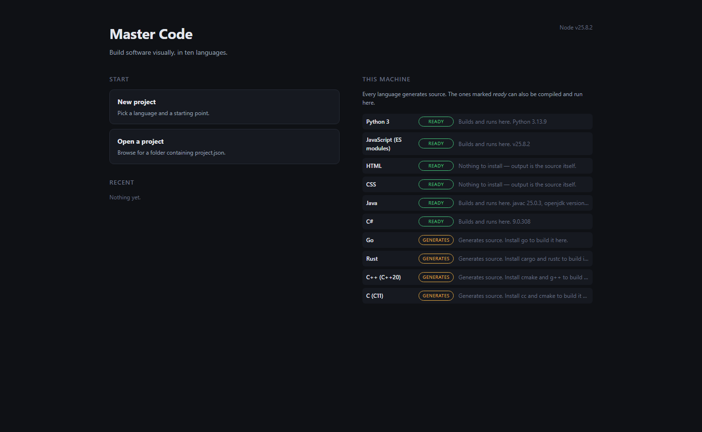
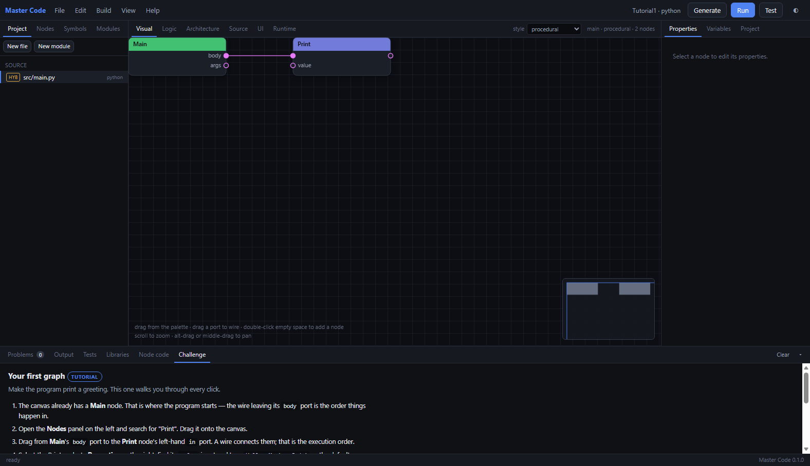
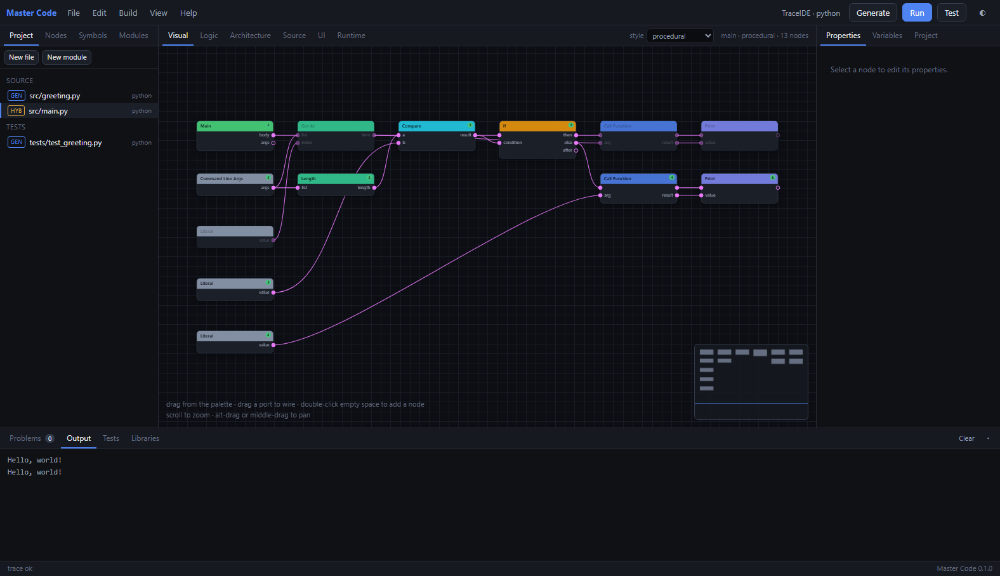
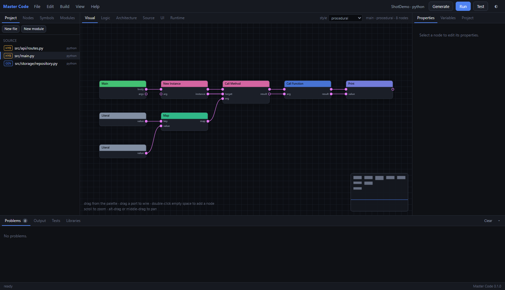
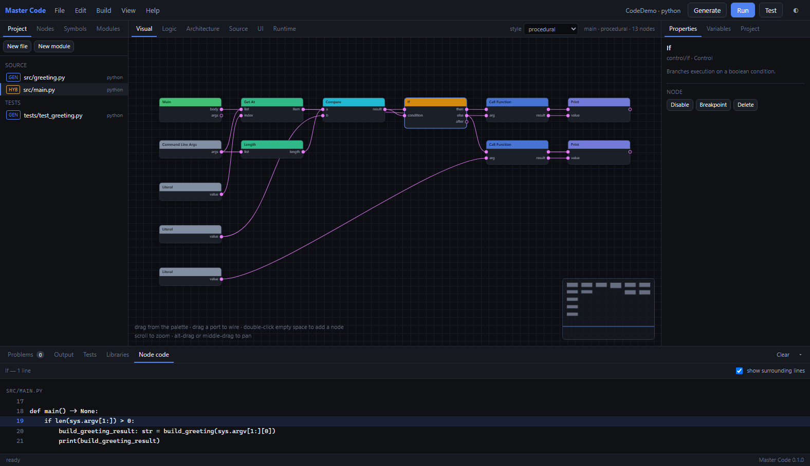
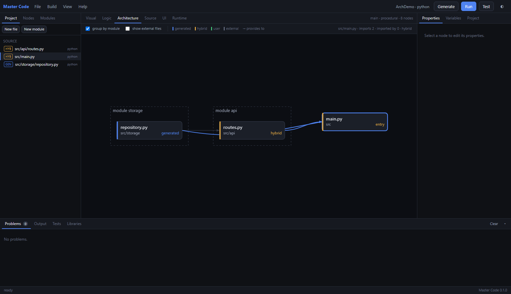

# Master Code

A visual compiler, IDE and multi-language application builder.

You build software by drawing a graph. The graph is lowered to a language-neutral
intermediate representation, and a language backend turns that IR into real,
readable source files — a multi-file project you could hand to a colleague who
has never heard of this tool.

```
        Intent
          ↓
   Semantic model          project, modules, file graph, logic graphs, UI documents
          ↓
   Intermediate rep.       types, functions, classes, statements, expressions
          ↓
   Language backend        Python · JavaScript · HTML · CSS · Java · C# · Go · Rust · C++ · C
          ↓
   Real source code        a project that builds and runs on its own
```

The distinction that matters: this is **not** a template collection. Templates
here are ordinary graphs a user could have drawn, and they can express nothing
the user cannot. The generality lives in the IR and the backends.

---

## Getting started

Requires **Node 22.6 or newer** and nothing else — no install step, no
`node_modules`, no build.

**Double-click `MasterCode.exe`.** Your browser opens on the welcome screen.



It reports what this machine can actually do before asking you to choose:
**ready** means the toolchain is installed and that language will build and run
here; **generates** means you get idiomatic source and a working manifest, and it
names the compiler to install if you want to run it too.

New project → pick a language → pick a starting point → name it → **Create**.
Prefer to learn by doing? **Learn by doing** gives you a guided tutorial and
then challenges from easy to hard, in whichever language you pick.


Then **Generate** turns the graph into source and **Run** builds and runs it. The
first Run will stop and say the program needs the `env` capability, naming the
node that asked — that is the design, not a bug, see
[Capabilities](#capabilities-and-the-sandbox).

No `.exe`? `Master Code.cmd` on Windows, `./master-code.sh` elsewhere. Rebuild
the launcher with `launcher/build.ps1` (needs the .NET SDK; the exe it produces
does not).

### From a terminal instead

Everything the IDE does is also a `mcode` command, because the IDE is a client of
the same core:

```sh
alias mcode='node "/path/to/Master Code/packages/cli/src/main.ts"'

mcode new Greeter --template python/cli
cd Greeter
mcode gen              # graph -> source
mcode grant env
mcode run -- Ada       # build and run under the sandbox
mcode test             # run the tests the graph defines
mcode doctor           # what this machine can build
```

---

## What is here

| | |
|---|---|
| **10 languages** | Python, JavaScript, HTML, CSS, Java, C#, Go, Rust, C++, C. Each is an adapter behind one interface; adding an eleventh is writing that interface, not editing the compiler. |
| **207 node types** | Control flow, data, collections, strings, maths, JSON, optionals, regular expressions, encoding, digests, files, HTTP in and out, scheduling, concurrency, SQLite, OOP, functional, pipelines, state machines, DOM, testing, and a Custom Code escape hatch. |
| **Multi-file output** | Real projects with real imports. References are stored by file id, so renaming a file updates every generated importer with no text rewriting. |
| **Nine paradigms** | Procedural, object-oriented, functional, event-driven, data-flow, state machine, pipeline, component, service — each with its own vocabulary in the palette. |
| **Round-trip safety** | Hand-written code inside marked regions survives regeneration; anything that loses its home is preserved to a `.orphaned` file rather than deleted. |
| **Library catalogue** | ~150 curated libraries across eight package managers, browsable offline, plus live registry search. Adding one writes the manifest; **nothing is ever downloaded** without an explicit, confirmed command. |
| **Capability sandbox** | Every node declares what it needs. A program whose graph requires a capability the project has not granted is refused before it is compiled. |
| **Plugins** | Languages, nodes, templates, exporters, importers and themes, through the same registries the built-ins use. |
| **CLI and IDE** | Everything the IDE does is a CLI command, because the IDE is a client of the same core. |
| **Layout is not structure** | Monolithic and modular are the same project arranged differently, so `mcode arch` converts either way and the imports follow. |

---

## The six views

The same project, six ways — all synchronised, none authoritative over the others
except the graph:

- **Visual** — the node editor: typed ports, colour-coded wires, live validation.
- **Logic** — the same graph as structured pseudocode, language-independent.
- **Architecture** — the *file* graph: which files exist, which module owns them,
  which imports which, and where the cycles are.
- **Source** — the generated code, exactly as it will be written to disk.
- **UI** — a builder for markup targets: widget tree, live preview at a chosen
  viewport width, and an inspector with two tabs — the selected widget (text,
  classes, attributes, inline styles, events) and the stylesheet (rules,
  declarations, and which breakpoint each applies at).
- **Runtime** — what the last run actually did, including the limits that were
  and were not enforced.

**Build → Run with trace** puts the result back on the graph: nodes that ran
carry their execution order, nodes that never ran are dimmed. A whole branch
greyed out is how you notice the condition was wrong.





The **Node code** tab in the bottom bar answers "what does this block become":
select a node and it shows the exact lines it produced, because the backends
record that while emitting rather than it being inferred afterwards.



A project has **two** graphs, and both are drawn rather than one being reduced to
a list. The logic graph is what happens *inside* a file — functions, branches,
data flow. The file graph is how the files relate: imports, modules, dependency
depth. Renaming a file changes one field and every generated import is
recomputed, which is only trustworthy if you can see the edges it recomputed.



Every edit is undoable — `Ctrl+Z` / `Ctrl+Shift+Z`, with the Edit menu naming
what it will undo ("Undo delete nodes"). History is kept by the server, next to
the project it applies to, so an undo refreshes the graph, the file tree, the
architecture view and the properties panel through the same path as any other
change.

---

## How it works

### The graph is not the program; the IR is

A node definition is data (ports, properties, docs) plus one function that
lowers an instance to IR. The lowering pass walks execution chains and pulls on
data edges, producing `IrModule`s. Backends only ever see IR — they never look
at a graph. That is what lets the same project target several languages, and
what keeps a node definition to a few dozen lines instead of ten per-language
cases.

### Two graphs, kept apart

```
                 PROJECT
                    │
        ┌───────────┴───────────┐
   FILE GRAPH               LOGIC GRAPH
   files, kinds             nodes, ports, edges
   imports, cycles          control and data flow
   modules, packages        one graph per file
```

Moving `models/user.py` to `domain/user.py` is a file-graph edit and touches no
node. Rewiring a function is a logic-graph edit and moves no file.

### Builtins are the backend contract

The IR has no standard library. It has ~120 named *builtin operations*, and each
backend maps them to whatever its language actually says — `len(x)` in Python,
`x.length` in JavaScript, `x.len()` in Rust. A backend that cannot implement one
raises a build error naming the node. It never guesses.

### Honest about what each backend can do

| Maturity | Meaning | Languages |
|---|---|---|
| `full` | Generates, builds and runs; exercised by this repo's test suite. | Python, JavaScript, HTML, CSS, Java, C#, Go, Rust |
| `generates` | Emits idiomatic source and a working manifest; no toolchain is exercised here. | C++, C |

C declares `closures: false`, `exceptions: false`, `generics: false`. A graph
using a Lambda node in a C file is refused up front with a message naming the
node — not emitted as something that will not compile.

---

## Capabilities and the sandbox

Every node declares the capabilities it needs (`fs.read`, `net`, `process`, …).
The lowering pass records them on the IR, and the sandbox compares them against
the project's grants **before anything is compiled**:

```
$ mcode run
error sandbox/capability-not-granted [node n_ms…]
  This program needs the "env" capability, which the project has not granted.
  Needed by 1 node.
  hint: Grant it in Project Settings, or with: mcode grant env
```

The runtime controls are real but narrower, and the platform says so rather than
implying more: process isolation, a wall-clock timeout with a tree kill, an
output cap, an environment allowlist, and a heap ceiling where the runtime has a
flag for one. Filesystem confinement, network blocking and CPU quotas are **not**
enforced — they need an OS-level sandbox this cannot build from Node. Every run
prints which limits applied and which did not. See [docs/security.md](docs/security.md).

---

## Libraries: listed, not downloaded

The catalogue is browsable with no network at all. Adding a library writes it to
`requirements.txt` / `package.json` / `Cargo.toml` / the relevant manifest and
stops there.

```sh
mcode libs                       # what is available, per language
mcode libs http --language python
mcode libs orm --language rust --online   # search crates.io directly
mcode add requests               # writes the manifest; downloads nothing
mcode install                    # shows the exact command, then asks
mcode install --yes              # actually runs pip / npm / cargo / dotnet
```

No offline list can be "every library" — the registries hold millions — so the
curated set covers common ground and `--online` reaches the real index.

---

## Command line

```
mcode new <name> [--template ID]     create a project
mcode templates                      list templates
mcode info                           files, modules, import counts
mcode validate                       type-check every graph and the file graph
mcode gen                            generate source
mcode build [--release]              generate, then compile
mcode run [--allow CAP,...] [-- ARG…] build and run under the sandbox
mcode test                           run the tests the graphs define
mcode trace                          run, and report which nodes executed
mcode export --out PATH              a standalone project that no longer needs us
mcode import <dir>                   read an existing codebase
mcode libs / add / remove / install  dependencies
mcode grant <capability>...          grant a capability
mcode mv <from> <to>                 move a file and fix references
mcode arch <modular|monolithic>      convert the project layout
mcode nodes [query]                  search the node catalogue
mcode doctor                         which toolchains are installed
mcode plugins                        what is loaded
```

---

## Repository layout

```
packages/core/src/
  model/        project, files, modules, graphs, UI documents
  types/        the type system: assignability, unification, display
  ir/           intermediate representation + the builtin operation contract
  nodes/        node definitions and the built-in catalogue
  lower/        graph -> IR, with validation and generic resolution
  backends/     one adapter per language, behind LanguageBackend
  filegraph/    file dependency graph, renames, cycle detection
  codegen/      orchestration and preserved regions
  project/      the on-disk format, the graph builder, templates
  libraries/    catalogue, registry search, install flow
  runtime/      process execution, toolchain probing, the sandbox
  build/        the build pipeline and diagnostic source mapping
  import/       reading an existing codebase
  testing/      running generated tests, mapped back to nodes
  plugin/       the plugin API and host
  ai/           optional, proposal-only assistance
packages/cli/         the mcode command line
packages/server/      the IDE server
packages/ide/public/  the browser IDE, including the welcome screen
launcher/             the Windows launcher (C#); build with launcher/build.ps1
plugins/              an example plugin
examples/             five real projects
docs/                 architecture, project format, plugin API, security
tests/                159 tests
```

---

## Documentation

- [docs/architecture.md](docs/architecture.md) — how a graph becomes source, and why the layers are where they are
- [docs/project-format.md](docs/project-format.md) — the on-disk format
- [docs/nodes.md](docs/nodes.md) — writing a node definition
- [docs/backends.md](docs/backends.md) — adding a language
- [docs/plugins.md](docs/plugins.md) — the plugin API
- [docs/security.md](docs/security.md) — what the sandbox does and does not enforce
- [docs/install.md](docs/install.md) — installation and toolchains

---

## Development

```sh
node --test "tests/*.test.ts"     # 159 tests, no install required
npx tsc -p tsconfig.json --noEmit # type-check (needs TypeScript)
node packages/cli/src/main.ts doctor
```

The whole repository runs from source on Node's native type stripping. Two
constraints follow from that and are worth knowing before you edit: no
TypeScript parameter properties, no `enum`, no namespaces — anything that is not
erasable will fail at load. `tsconfig.json` sets `erasableSyntaxOnly` so the
type-checker catches it first.

## Status

A working prototype, honest about its edges. The vertical slice — create,
validate, generate, build, run, debug, test, export — works end to end for
Python, JavaScript, Java and C#, and the other six languages generate real
source. What is stubbed or unenforced is labelled as such in the code and in
these docs, not glossed over.

MIT licensed.
